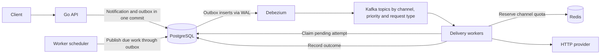

# Event-driven notification service

Submit SMS, email or push notifications, individually or in batches of up to 1,000. The API records work in PostgreSQL before replying. Workers deliver it asynchronously and share a rolling limit of 100 provider attempts per second per channel.

## Run one notification

From a fresh checkout, start Docker Compose v2 and send a synthetic SMS to the bundled simulator. The first start downloads the images and registers the CDC connector.

```sh
docker compose up --build -d --wait
api=http://127.0.0.1:8080
curl -fsS "$api/v1/notifications" -H 'Content-Type: application/json' \
  -H 'Idempotency-Key: first-demo' \
  -d '{"channel":"sms","recipient":"+12025550123","content":"Your order is ready","priority":"high"}'
```

Copy the returned `id` into the command below. The create response (`202`) confirms that the API saved the notification. Once the provider acknowledges it, the query returns `"status":"accepted"` and its `messageId`. A recipient delivery receipt would require a separate provider signal.

```sh
curl -fsS "$api/v1/notifications/<id>"
```

To exercise the **external provider in the assessment**, run `scripts/webhook-smoke.sh`. It starts an isolated Compose project, configures a disposable Webhook.site endpoint, sends one synthetic email and checks both the persisted receipt and captured POST. [Manual configuration and example acknowledgement](docs/webhook-site.md)

## Review the implementation

| Question | Where to look |
| --- | --- |
| Which requirements and bonuses are covered? | [Assessment checklist](reports/assessment-requirements.md), [API examples](docs/api-examples.md), [OpenAPI](openapi.yaml) |
| Why this queue and delivery policy? | [Decisions and state diagram](docs/decisions.md), [measured alternatives and contributions](docs/decision-history.md) |
| Which results matter under load or after a crash? | [Four measured scenarios, test commands and complete evidence archive](reports/README.md) |

## Delivery path



- **Admission.** A required `Idempotency-Key` identifies each create request. Repeating the same key and body returns the original IDs. Batch admission returns indexed errors for invalid items. Both the 1,000-item maximum and the 5 MiB request-body limit apply.
- **Dispatch.** PostgreSQL keeps the payload. Kafka distributes ready IDs. A shared worker pool selects high, normal and low priority in a 6:3:1 ratio when all are ready. Within a priority, batches receive a default 20% share while standalone traffic is waiting. With the default `BATCH_ROUTING=isolated`, each channel has independent readers for standalone and batch work. [Upgrade and rollback](docs/channel-batch-routing.md)
- **Cancellation.** A notification can be cancelled while waiting for quota. Cancellation and the first send compete for the same PostgreSQL row. Once the worker changes it to `sending`, cancellation closes. A replay cannot claim the same attempt twice.
- **Retries.** The local simulator declines a throttled POST before accepting the notification. Its `429` triggers a retry after at least `Retry-After`. The default budget is six total attempts with exponential backoff and jitter starting from two seconds. For an external provider, enable `PROVIDER_429_NOT_ACCEPTED=true` only if its contract guarantees this behavior. A gateway `503` with `Retry-After` leaves a non-idempotent submission `unknown`. [Retry policy](docs/decisions.md#implementation-choices-for-this-assessment)
- **Receipts and diagnosis.** The assessment's Webhook.site contract uses HTTP 202 with a message ID, accepted status and a formatted timestamp. If a different provider documents a successful 2xx response with a message ID as authoritative acceptance, select `PROVIDER_ACK_MODE=message_id`. The default is `assessment`. Repeated Webhook.site 403/404 responses pause that channel so an operator can check endpoint access. The status API exposes the recorded reason and provider HTTP code. Use the create request's `X-Correlation-ID` to find its structured API and worker logs. [Example receipt](docs/webhook-site.md) · [Operator guide](docs/operations.md)

## API and verification

| Operation | Endpoint |
| --- | --- |
| Create one / create a batch | `POST /v1/notifications` / `POST /v1/batches` |
| Read one / read a batch | `GET /v1/notifications/{id}` / `GET /v1/batches/{id}` |
| Read retained status history | `GET /v1/notifications/{id}/history` |
| List, filter and paginate | `GET /v1/notifications` |
| Cancel pending / watch snapshots | `POST /v1/notifications/{id}/cancel` / `WS /v1/notifications/{id}/events` |
| API database readiness / operational metrics | `GET /healthz` / `GET /metrics` |

| Command | What it exercises |
| --- | --- |
| `make test` | Unit tests. Service-dependent tests skip when their dependencies are absent. |
| `make ci` | Lint, vulnerability scan, unit and race tests, builds, live OpenAPI checks and Docker-backed integration |
| `make verify-all` | Local CI, benchmarks, load matrix, worker shutdown and dependency interruptions |
| `make performance`, `make load`, `make stress`, `make burst` | Isolated Go benchmarks or individual traffic profiles |
| `make sustained-mixed` | 15-minute SMS, email and push workload, with a per-ID audit |
| `make package` | Source archive, native executables and checksums for the current commit |

For a port conflict, set `API_PORT=18080` before starting Compose and use `http://127.0.0.1:18080`. `docker compose down` stops the stack and retains its data. The [verification guide](docs/verification.md) lists host prerequisites, timings and result files. The [operations guide](docs/operations.md) covers queues, investigation by ID and ambiguous outcomes. [Tracing](docs/tracing.md) and the [historical outcome report](docs/outcome-report.md) cover cross-service diagnosis and UTC reporting.

I chose the delivery guarantees and scheduling policy, and used a coding assistant for implementation and experiments. [Decisions, alternatives and measurements](docs/decision-history.md)

## Operating limits and further improvements

| Current boundary | Next change and evidence needed |
| --- | --- |
| Webhook.site simulates HTTP acceptance. Production providers differ on rate limits, idempotency windows and receipts. | Test a lost acknowledgement and a documented throttle response against the actual provider. Identify a stable reference for lookup before enabling automatic reconciliation. |
| Compose runs a single PostgreSQL, Kafka and Redis node. Replay keys are retained. Cleanup of history and published outbox events is opt-in. | Choose [retention windows and a cleanup schedule](docs/persistence.md), then validate failover and disk use under sustained writes. A seeded 2.16-million-row database took 444 ms per median metrics scrape in the [original volume experiment](https://github.com/EfeDurmaz16/notification-system/blob/4ca75cc9c4dca3265da3888553d880be324e7059/reports/volume-simulation/README.md). |
| The caller supplies recipients in a single trusted namespace. | For multi-tenant traffic, authenticate and scope keys and reads by tenant. For audience selection, add campaign progress and consent checks. |
| The 100/s quota is a ceiling. With 1,500 standalone SMS and 30 email probes, one worker completed 77.0–77.1 SMS/s in two runs. | For a new provider, measure receipt latency, retries and queue age at the intended concurrency before setting a delivery-time target. [Standalone channel measurements](reports/README.md#standalone-channel-isolation) |
