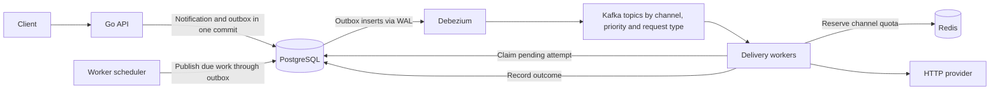

# Event-driven notification service

Submit SMS, email or push notifications, individually or in batches of up to 1,000. The API records work in PostgreSQL before replying. Workers deliver it asynchronously and share a rolling limit of 100 provider attempts per second per channel.

## Run one notification

From a fresh checkout, start Docker Compose v2 and send a synthetic SMS to the bundled simulator. The first start downloads the images and registers the CDC connector.

```sh
docker compose up --build -d --wait
api=http://127.0.0.1:8080
curl -fsS "$api/v1/notifications" -H 'Content-Type: application/json' \
  -H 'Idempotency-Key: first-demo' \
  -d '{"channel":"sms","recipient":"+12025550123","content":"Your order is ready","priority":"high"}'
```

Copy the returned `id` into the command below. The create response (`202`) confirms that the API saved the notification. Once the provider acknowledges it, the query returns `"status":"accepted"` and its `messageId`. A recipient delivery receipt would require a separate provider signal.

```sh
curl -fsS "$api/v1/notifications/<id>"
```

To exercise the **external provider in the assessment**, run `scripts/webhook-smoke.sh`. It starts an isolated Compose project, configures a disposable Webhook.site endpoint, sends one synthetic email and checks both the persisted receipt and captured POST. [Manual configuration and example acknowledgement](docs/webhook-site.md)

## Choose the provider and response time

By default the worker posts to `http://provider:8081/send`. This local simulator records each accepted request, waits **20 ms per request**, then returns the receipt. Concurrent requests wait in parallel. The worker adds no artificial delay when calling an external endpoint.

| To try | How to run it |
| --- | --- |
| Measure the local system with zero simulated wait | On the running demo stack, run `PROVIDER_LATENCY=0ms docker compose up -d --no-deps --wait provider`. Repeat with `20ms` to restore the benchmark default. |
| Use your own HTTP provider | In a shell on a fresh stack, `export PROVIDER_URL='https://your-provider.example/send'`, then `docker compose up --build -d --wait`. Workers post directly to that URL. Use the single-create example above. |

The default acknowledgement contract expects HTTP 202 with a JSON `messageId`, `status: "accepted"` and an RFC 3339 `timestamp`. An empty 200 leaves the outcome `unknown`. Keep the URL exported when resizing the same stack. Before returning to the simulator, unset `PROVIDER_URL` and run `docker compose up -d --wait`. [Example receipt and other provider contracts](docs/webhook-site.md#configure-a-capture-by-hand)

## Increase and decrease the worker count

On the running Compose stack, change only the delivery service. You can submit notifications before and after each change and follow the same IDs through the API.

```sh
docker compose up -d --no-deps --scale worker=3 --wait worker
docker compose ps worker
docker compose up -d --no-deps --scale worker=1 --wait worker
```

Each replica defaults to 24 concurrent delivery slots (`WORKER_CONCURRENCY`). All replicas share the same 100 attempts/s per channel. Kafka redistributes partition ownership when membership changes. On a fresh stack, a single channel at one priority has three standalone partitions and one batch partition, so adding replicas need not speed up one busy batch topic.

To try **automatic scaling under load**, run `make wave RESULTS=.local/reviewer` with Docker Compose, Make and Python 3. The experiment uses its own local simulator at 20 ms. It replays the same SMS traffic (20 → 60 → 90 → 150 → 90 → 60 → 20 SMS/s) with one fixed replica, three fixed replicas, a preset replica schedule and a controller that reacts to queue depth and age. The controller runs only during the experiment.

Allow about 12 minutes of traffic plus startup and drain. Compare the four JSON files under `.local/reviewer/traffic-wave/`. Each reports replica changes (`scaleActions`), end-to-end latency (`p95Seconds`), throughput including drain (`acceptedPerSecondThroughWaveAndDrain`) and POST counts by notification ID (`receiptAudit`). For the separate high-quota test, see [Replay the 100,000-SMS comparison](docs/channel-batch-routing.md#replay-the-100000-sms-comparison).

## Review the implementation

| Question | Where to look |
| --- | --- |
| Which requirements and bonuses are covered? | [Assessment checklist](reports/assessment-requirements.md), [API examples](docs/api-examples.md), [OpenAPI](openapi.yaml) |
| Why this queue and delivery policy? | [Decisions and state diagram](docs/decisions.md), [measured alternatives and contributions](docs/decision-history.md) |
| Which results matter under load or after a crash? | [Traffic measurements, recovery tests and evidence archive](reports/README.md) |

## Delivery path



- **Admission.** A required `Idempotency-Key` identifies each create request. Repeating the same key and body returns the original IDs. Batch admission returns indexed errors for invalid items. Both the 1,000-item maximum and the 5 MiB request-body limit apply.
- **Dispatch.** PostgreSQL keeps the payload. Kafka distributes ready IDs. A shared worker pool selects high, normal and low priority in a 6:3:1 ratio when all are ready. Within a priority, batches receive a default 20% share while standalone traffic is waiting. With the Compose default `BATCH_ROUTING=isolated`, each channel has independent readers for standalone and batch work. [Upgrade and rollback](docs/channel-batch-routing.md)
- **Cancellation.** A notification can be cancelled while waiting for quota. Cancellation and the first send compete for the same PostgreSQL row. Once the worker changes it to `sending`, cancellation closes. A replay cannot claim the same attempt twice.
- **Retries.** A DNS or dial failure before the worker acquires a connection is safe to retry. The worker also retries a `429` from the simulator, which rejects the request before acceptance. The delay is the greater of `Retry-After` and exponential backoff with jitter (two-second base, six total attempts). For another provider, enable `PROVIDER_429_NOT_ACCEPTED=true` only if it guarantees the same rejection semantics. [Try a retry with the simulator](docs/api-examples.md#watch-a-retry-in-the-local-simulator)
- **Unknown outcomes.** `unknown` means the worker cannot tell whether the provider accepted the notification. A gateway 5xx (even a 503 with `Retry-After`), a read timeout or a lost reply can follow a successful submission. The default worker stops resending. A provider with a documented idempotency guarantee permits retries with the same ID and payload inside its key window. [Delivery policy](docs/decisions.md#implementation-choices-for-this-assessment)
- **Receipts and diagnosis.** The default `assessment` mode requires HTTP 202, a message ID, accepted status and a formatted timestamp. The literal placeholder `"ISO8601"` leaves the attempt `unknown`. Select `PROVIDER_ACK_MODE=message_id` only when another provider defines a 2xx response with a message ID as proof of acceptance. Inspect the reason and HTTP status through the API, then use the create request's `X-Correlation-ID` to find its structured API and worker logs. [Receipt examples](docs/webhook-site.md) · [Endpoint failures and pauses](docs/operations.md#provider-outage-cooldown)

## API and verification

| Operation | Endpoint |
| --- | --- |
| Create one / create a batch | `POST /v1/notifications` / `POST /v1/batches` |
| Read one / read a batch | `GET /v1/notifications/{id}` / `GET /v1/batches/{id}` |
| Read retained status history | `GET /v1/notifications/{id}/history` |
| List, filter and paginate | `GET /v1/notifications` |
| Cancel pending / watch snapshots | `POST /v1/notifications/{id}/cancel` / `WS /v1/notifications/{id}/events` |
| API database readiness / operational metrics | `GET /healthz` / `GET /metrics` |

| Command | What it exercises |
| --- | --- |
| `make test` | Unit tests. Service-dependent tests skip when their dependencies are absent. |
| `make ci` | Lint, vulnerability scan, unit and race tests, builds and live OpenAPI checks. Compose exercises integration, Kafka quarantine, graceful worker drain and recovery of an accepted provider receipt. |
| `make verify-all` | Local CI, benchmarks, load matrix, worker shutdown and dependency interruptions |
| `make performance`, `make load`, `make stress`, `make burst` | Isolated Go benchmarks or individual traffic profiles |
| `make sustained-mixed` | 15-minute SMS, email and push workload, with a per-ID audit |
| `make package` | Source archive, native executables and checksums for the current commit |

For a port conflict, set `API_PORT=18080` before starting Compose and use `http://127.0.0.1:18080`. `docker compose down` stops the stack and retains its data. The [verification guide](docs/verification.md) lists host prerequisites, timings and result files. The [operations guide](docs/operations.md) covers queues, investigation by ID and ambiguous outcomes. [Tracing](docs/tracing.md) and the [historical outcome report](docs/outcome-report.md) cover cross-service diagnosis and UTC reporting.

I chose the delivery guarantees and scheduling policy, and used a coding assistant for implementation and experiments. [Decisions, alternatives and measurements](docs/decision-history.md)

## Operating limits and further improvements

| Current boundary | Next change and evidence needed |
| --- | --- |
| Webhook.site simulates HTTP acceptance. Production providers differ on rate limits, idempotency windows and receipts. | Test a lost acknowledgement and a documented throttle response against the actual provider. Identify a stable reference for lookup before enabling automatic reconciliation. |
| Compose runs a single PostgreSQL, Kafka and Redis node. Replay keys are retained. Cleanup of history and published outbox events is opt-in. | Choose [retention windows and a cleanup schedule](docs/persistence.md), then validate failover and disk use under sustained writes. The current schema maintains counts and latency buckets as outcomes change. [Metrics storage and upgrade considerations](docs/persistence.md#metrics-over-long-histories) |
| The caller supplies recipients in a single trusted namespace. | For multi-tenant traffic, authenticate and scope keys and reads by tenant. For audience selection, add campaign progress and consent checks. |
| The 100/s quota is a ceiling. With 1,500 standalone SMS and 30 email probes, one worker completed 77.0–77.1 SMS/s in two runs. | For a new provider, measure receipt latency, retries and queue age at the intended concurrency before setting a delivery-time target. [Standalone channel measurements](reports/README.md#standalone-channel-isolation) |
