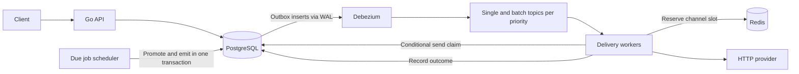

# Event-driven notification service

A Go service for accepting SMS, email and push notifications and submitting them to an HTTP provider. Clients can create up to 1,000 items in a request, follow progress, and cancel a notification until its first send starts. PostgreSQL records the accepted work. Kafka distributes ready events. A Redis limiter coordinates delivery attempts across worker replicas.

## Run locally

Install Docker with Compose v2 or later. From the repository root:

```sh
docker compose up --build -d
curl http://127.0.0.1:8080/healthz
docker compose ps -a
```

If port 8080 is occupied, prefix Compose commands with `API_PORT=18080` and use `http://127.0.0.1:18080` for the API. For make targets also set `API_URL=http://127.0.0.1:18080`.

The first run downloads the service images, applies versioned SQL migrations, creates Kafka topics, and registers the PostgreSQL CDC connector. Wait for the API health check and the connector-init job to finish before measuring delivery. The default provider is a local simulator. The development ports bind to loopback. Go 1.26.4 is used for host-side builds and tests.

```sh
curl -sS http://127.0.0.1:8080/v1/notifications \
  -H 'Content-Type: application/json' \
  -H 'Idempotency-Key: example-001' \
  -d '{"channel":"sms","recipient":"+12025550123","content":"Your order is ready","priority":"high"}'
```

A successful create returns HTTP 202 with an ID and batch ID. Poll `GET /v1/notifications/{id}`, or connect a WebSocket to `/v1/notifications/{id}/events`. The provider's subsequent 202 records `accepted`: the provider accepted the submission. Recipient receipts require an additional provider contract.

See [OpenAPI](openapi.yaml) for the full HTTP contract and [API examples](docs/api-examples.md) for batches, scheduling, templates and reconnects. [Webhook.site setup and verification](docs/webhook-site.md) uses a disposable endpoint and one synthetic message. Run load experiments only with the local simulator.

## Delivery path



1. Create validates each item, expands templates and fingerprints the request. A transaction stores the batch replay response, immutable accepted payloads and ready outbox events. Invalid items get indexed errors. A repeated key and matching payload returns the original IDs. A conflicting valid payload gets HTTP 409.
2. Debezium routes ready events to a single or batch topic within each priority. The create endpoint sets the lane, including for one-item batches. PostgreSQL preserves it for scheduled deliveries and retries. Consumers load the notification by ID and attempt generation.
3. The shared worker pool chooses a priority with weights 6:3:1 for high, normal and low. Within each priority, standalone requests get more turns. Batch requests continue to receive turns during sustained standalone traffic. Either lane can take all available turns when the other is empty. Both share the channel's Redis quota.
4. A worker changes the matching pending generation to sending in PostgreSQL before making a POST. A successful cancellation prevents that transition. Even if Kafka replays a ready event, the DB predicate fences workers from consuming the same send right.
5. The worker stores the outcome before the consumer commits the fetched offsets. A future retry or scheduled send is promoted by a DB scheduler. The promotion and its outbox insert share a transaction.

The [design decisions and state diagram](docs/decisions.md) explain the options, defaults and recovery boundaries.

See the [standalone versus batch measurements](reports/ingress-share/README.md) to compare dispatch shares under sustained, sparse and single-lane traffic.

## Delivery contract

| Outcome | Worker action |
|---|---|
| Confirmed dial failure before a request was sent | Schedule bounded exponential backoff with jitter. Four attempts including the first. |
| Valid provider 202 with message ID, accepted status and timestamp | Store provider acceptance and message ID. |
| Explicit permanent rejection, such as an invalid recipient (400) | Mark failed. |
| Lost response, malformed acknowledgment, or ambiguous error | Record unknown for a webhook-style provider. Investigate by notification ID before deciding whether to send a new notification. |
| Provider explicitly guarantees idempotency | Reuse the notification ID as the provider key. A bounded retry must fit inside the configured key-retention window. |
| Worker disappears while sending | Recover stale sends after two minutes. A webhook-style provider leaves the outcome unknown; an idempotent provider may retry within its remaining attempt and time budget. |

The client create key identifies API intent. The provider key identifies a single notification across attempts. The rate limiter tracks each attempt separately. Cancellation succeeds only before the first send right is acquired. The first-stage TDD transcripts are in [reports/tdd](reports/tdd).

## Verification and packaging

| Command | Scope |
|---|---|
| `make verify-all` | Full local suite including benchmarks, load matrix and isolated fault tests. [Verification guide](docs/verification.md) |
| `make check` | Formatting, vet, unit tests, race detector, binary build |
| `make ci` | Local checks, Compose, database integration tests and end-to-end smoke |
| `make burst`, `make load`, `make stress`, `make failures` | Independent local traffic and failure experiments |
| `make performance` | Repeated isolated Go benchmarks and allocation counts |
| `make package` | Source archive, native executables and SHA-256 checksums for the current commit |
| `docker compose up -d --scale worker=3` | Exercise the same channel budget with three workers |
| `docker compose down` | Stop the stack and retain data volumes |

[Verification results and review guide](reports/README.md) include measurements of this implementation, the environment and the exact scope of each run. Run the complete replica and workload comparison with `scripts/bench.sh` against an isolated, idle stack. It temporarily scales workers and resets the local simulator counters. See [failure investigation](docs/operations.md) for manual inspection. The CI workflow runs on GitHub. The release workflow can build a versioned container image and publish packages on a version tag.

## Observability and operating assumptions

- `/metrics` exposes logical pending depth, oldest pending age, state counts, terminal outcome counters and an acceptance latency histogram. `/healthz` checks API database readiness. Worker and connector health are separate from admission readiness.
- JSON logs link requests and worker outcomes to identifiers. [Distributed tracing](docs/tracing.md) shows the API, worker and provider boundary with W3C propagation and optional OTLP export.
- The notification row is authoritative. WebSocket subscribers receive current snapshots, may skip intermediate states, and can refetch the resource after reconnecting.
- The simulator and single-node PostgreSQL, Kafka and Redis volumes model process restarts on a development host. Production HA, authenticated tenants, retention and provider receipts require deployment-specific configuration. The API uses one trusted client namespace. Keep the default bindings on loopback.
- Retain outbox rows, notification history, and replay keys for the assessment. Capacity planning must account for these tables and WAL growth during outages. Terminal failed and unknown items remain queryable by status. Malformed stream envelopes are quarantined separately.
