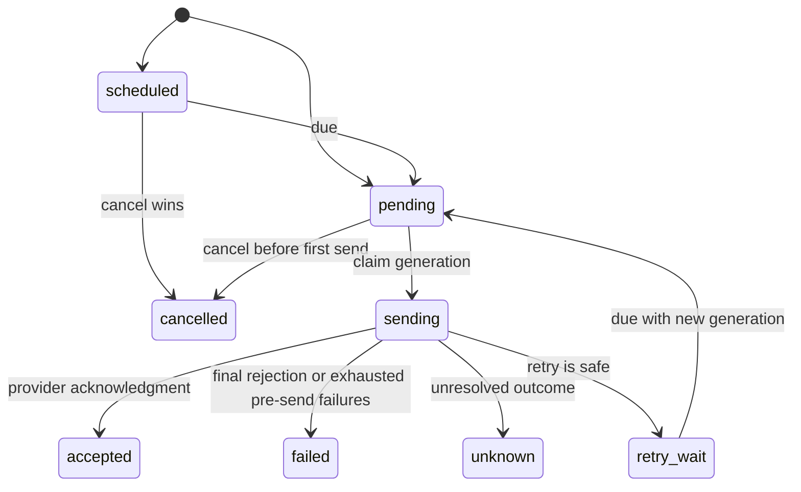

# Delivery decisions

## Product guarantees

| Choice | Consequence for the caller |
|---|---|
| Commit the batch and outbox before replying | On a successful create, each accepted item can immediately be queried. Kafka can be temporarily offline. |
| Require a create idempotency key | Retries of the same intent return the same IDs. A batch keeps the original index of each item error. A repeated key with a different valid request conflicts. |
| Keep recipients and rendered messages immutable | A safe provider retry can use the same key and identical parameters. Two independent campaigns may contain identical content. |
| Allow cancellation until the first send claim | A 204 cancellation wins a conditional state transition. No POST can follow for that notification. A consumer reading a cancelled event skips the send. |
| Independent notifications | An ambiguous campaign SMS cannot hold up a later security alert to the same recipient. Kafka order within a partition supplies no handset delivery guarantee. |
| Preserve an ambiguous HTTP outcome | Webhook-style integrations park it as unknown. A provider with a documented idempotency window may retry with the original notification ID. |
| Budget per channel across all replicas | Retries count. An unavailable coordinator pauses new sends. Backlog stays durable while the API can still commit. |
| Favor standalone work within each priority | A standalone request can bypass a campaign of the same priority. A locally ready batch receives a configurable share of dispatches during contention. Each lane can use idle capacity. |

## Implementation choices for this assessment

- PostgreSQL owns current state, immutable create receipts, the outbox, scheduling deadlines and status history. Queries use the same authoritative database. Separate CQRS read infrastructure would add a replication delay to status and cancellation reads.
- Kafka and Debezium support durable, independently replayable consumer groups. Redis coordinates shared channel permits. Adding Redis Pub/Sub or MQTT to the delivery path would introduce another publication boundary.
- Each priority has a three-partition standalone topic and three single-partition batch topics, one per channel. The original three-partition batch topic remains readable during upgrades. One Go executable runs in API or worker mode. A worker instance also polls for due retries and scheduled items every 250 ms. Row locks allow multiple schedulers to coexist.
- Retry defaults are four attempts, capped exponential backoff with jitter, and a five-second provider timeout. A two-minute stale-send grace exceeds an ordinary HTTP attempt. Provider idempotency is opt-in; configure its real retention window before enabling it.
- For the demo, content limits are 160 Unicode code points for SMS, 10,000 for email and 256 for push. This validates the exercise's character limits; carrier billing and SMS segmentation need provider-specific rules. Templates accept literal variables and render once at admission.
- One trusted caller namespace, loopback ports, retained status history, and a single node for each infrastructure dependency keep the exercise reproducible. Multi-tenant auth, long-term retention, standby failover and cross-region quotas need deployment-specific decisions.
- Status updates use WebSocket snapshots and the same durable query used by HTTP. The optional tracing profile collects OTLP spans in Jaeger; the metrics endpoint emits Prometheus text.

Further reading: [Kafka concepts](https://kafka.apache.org/intro/), [PostgreSQL logical decoding](https://www.postgresql.org/docs/current/logicaldecoding-explanation.html), [safe retries](https://aws.amazon.com/builders-library/making-retries-safe-with-idempotent-APIs/), [Uber Go style](https://github.com/uber-go/guide), [Effective Go](https://go.dev/doc/effective_go).

## Default batch share

Use a 20% batch weight within each priority. Oracle's ERP example gives interactive transactions 80% of CPU and allows batch jobs to consume at least 20% plus unused capacity. In SMS, Twilio illustrates a 100-message/s sender with a 70/30 split between important and regular traffic and redistributes idle capacity. These examples allocate different resources and classify traffic differently. [Oracle Resource Manager example](https://docs.oracle.com/html/E25494_01/dbrm007.htm) · [Twilio Traffic Shaping](https://www.twilio.com/docs/messaging/features/traffic-shaping)

At the 20% setting our two local saturation runs gave batches 25 to 30 send claims/s and standalone traffic 58 to 60/s. A 10% setting shortened standalone p95 by about four seconds and reduced campaign progress. A 40% setting raised campaign progress to about 42/s and pushed standalone p95 above 21 seconds. For a deployment with a campaign deadline, divide the number of messages by the available seconds, then choose the smallest tested share that can sustain that batch rate while meeting the standalone latency target. [Measured tradeoffs](../reports/ingress-share/README.md)

## State transitions

