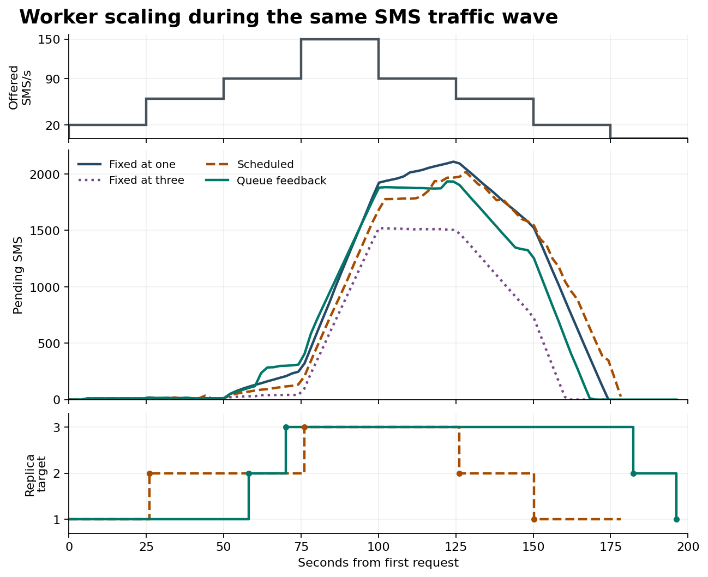

# Worker scaling during a traffic wave



## Results

The backlog-triggered controller reduced whole-wave acceptance p95 from 32.08 s with one worker to 25.14 s. Keeping three replicas warm reached 18.13 s. During the 175 s input window the controller used 25.2% fewer replica-seconds than fixed three and 124.4% more than fixed one. Each policy ran once.

| Raw report | Accepted p95 (s) | Accepted p99 (s) | Peak pending | Oldest pending (s) | Replica-seconds | Confirmed accepts/s including drain | Peak POSTs/rolling s | Application unknown |
| --- | ---: | ---: | ---: | ---: | ---: | ---: | ---: | ---: |
| [fixed](fixed.json) | 32.08 | 36.82 | 2,109 | 38.14 | 175.00 | 70.00 | 89 | 0 |
| [scripted](scripted.json) | 43.12 | 50.69 | 2,018 | 53.91 | 349.27 | 68.56 | 93 | 1 |
| [feedback](feedback.json) | 25.14 | 26.86 | 1,934 | 28.12 | 392.76 | 70.00 | 94 | 0 |
| [fixed3](fixed3.json) | 18.13 | 19.54 | 1,520 | 20.79 | 525.00 | 70.00 | 94 | 0 |


The four HTTP receipt audits found one POST per ID for all 49,000 IDs. The fixture accepted each POST. PostgreSQL had 48,999 confirmed acceptances and one unknown. All trials finished with committed Kafka lag zero on all three normal-batch partitions.

During fixed-three, the three worker containers used **28.226 CPU-seconds over 175.229 seconds**, or 0.161 CPU cores in aggregate on average. Each of the three distinct private cgroups was sampled at both ends. This covers the worker processes and excludes PostgreSQL, Kafka, Redis, API, CDC and provider CPU. It does not resolve individual goroutine time spent in Redis permit waits, network I/O or scheduling.

## Workload

The checked Go service is revision `5024e68`. The trial uses PostgreSQL, Debezium, Kafka, Redis and the local recording HTTP provider. Each policy receives the same open-loop wave of normal-priority batch SMS, in batches of ten. Each phase lasts 25 seconds. Offered rates are 20, 60, 90, 150, 90, 60 and 20 SMS/s, for 12,250 notifications in 175 seconds. Three trials start with one worker. A separate always-three control warms all three Kafka assignments before the first arrival. Every worker has 24 concurrent handlers. All trials use a 20 ms simulated provider delay and a shared SMS quota of 100 attempts per rolling second. Each starts after a warm-up and a reset of the isolated provider's counters.

| Policy | Replica decision |
| --- | --- |
| Fixed | One replica throughout. |
| Scripted | Request 1, 2, 2, 3, 3, 2 and 1 replicas for the seven phases, independently of queue measurements. |
| Fixed three | Three warm replicas throughout. Verify three owners of the three normal-batch partitions before timing. |
| Feedback | Poll the existing public queue metrics every two seconds. Add one replica when at least 100 notifications are pending and the oldest has waited at least one second. Remove one after 12 consecutive seconds at or below 20 pending with the oldest younger than 0.6 seconds. Wait at least 12 seconds between actions. Stay between one and three replicas. |

The feedback controller uses observed queue depth, oldest pending age and time since its last action. Its decisions are independent of the phase schedule. It acts through Docker Compose in this disposable experiment. Runtime sampling, replica changes, Kafka inspection and load submission execute independently, so scaling does not pause scheduled arrivals. Compose uses its normal stop signal for a removed replica. A worker receiving that signal can cancel a provider request already in flight.

## Observed feedback decisions

The feedback controller requested 1 to 2 replicas at 58.1 seconds (104 pending, oldest 1.214 s), then 2 to 3 at 70.1 seconds (300 pending, oldest 5.677 s). At 182.3 and 196.3 seconds the queue was empty and the controller returned to two and one replica respectively. These scale-in decisions happened after the 175-second input wave. Resource comparisons cover the same 175-second window and exclude that cooldown. The harness waited for one running worker and every terminal status before the receipt audit.

For arrivals in the first 90/s phase the feedback cohort p95 was 7.18 s, compared with 3.69 s at fixed one. The 150/s ingress phase measured 21.86 s versus 35.02 s and the final 20/s phase measured 12.91 s versus 17.42 s. Scale-out starts a Kafka assignment change. Snapshots show successive owners, while queue waiting includes CDC, Kafka, dispatch and rate-limit delays.

## Scale-in while work remained queued

At 126.2 seconds the scripted policy requested three to two replicas with 1,975 items pending. At 150.2 seconds it requested two to one with 1,544 pending. ID `14345a3a-1f28-42e9-af8e-4e619afa2d0e` was admitted in phase five. Its PostgreSQL status events (UTC) were `pending` at 22:15:48.194952, `sending` at 22:16:35.374978 and `unknown` at 22:16:35.391021 on November 20, 2026. Its receipt ID was empty. The unknown transition occurred 150.534 seconds after the first notification's database creation, close to the second scale-in. The recording provider accepted that ID once. The 16 ms interval from sending to unknown rules out a two-minute stale-send timeout for this ID.

## Measurements

Per-phase p95 is calculated over the notifications **created in that phase**, using PostgreSQL creation time to persisted provider acceptance. Responses with uncertain outcomes are counted separately. This definition excludes the initial HTTP request overhead. The per-ID HTTP receipt audit runs after traffic has finished and terminal statuses have been persisted. The application and the test provider have independent records. The outcome table in each raw report includes non-accepted statuses and every ID with other than exactly one POST.

The timeline samples pending depth, oldest pending age, provider POST count and observed running replicas about every two seconds. Replica-seconds integrate this sampled replica count over the same 175-second traffic window for each policy. This measures the provisioned concurrency that was available. The fixed-three CPU samples measure processor time separately. Whole-wave throughput divides confirmed accepts by the larger of 175 seconds and the elapsed time to the last terminal state. It includes the opening and closing low-load phases. Under overload, the offered rate exceeds the shared quota regardless of replica count. Kafka ownership and committed lag are measured independently about every 13 seconds. Owner snapshots can miss short rebalances between samples. Fixed, scripted and feedback run in that order on one project, retaining prior terminal rows and Kafka history. The fixed-three control runs last on a fresh project. Each is one local observation. A separate quarantine test completed on this host during the first 30 seconds of the fixed-one run. Its single provider POST and broker were isolated from the wave. The active cohort uses fresh IDs, independent receipt counters and an exclusive queue.

## Reproduce

Run the following command from the repository root with local Docker Compose and Python 3 available.

```sh
python3 -B scripts/traffic-wave.py --out-dir .local/traffic-wave
```

The harness builds its own image and starts an isolated Compose project with dynamic loopback ports and an internal recording provider. It removes its containers, network and volumes on exit. The raw output is one JSON file per policy. The fourth control also records per-worker Linux cgroup v2 CPU usage across the 175-second wave when private cgroups are available. Stable container IDs and distinct cgroup inodes identify the same three workers at both samples. A channel quota violation, a duplicate POST, a missing accepted receipt, undrained offsets or a missing scaling transition fails verification. The harness records exceptions by notification ID for inspection.
